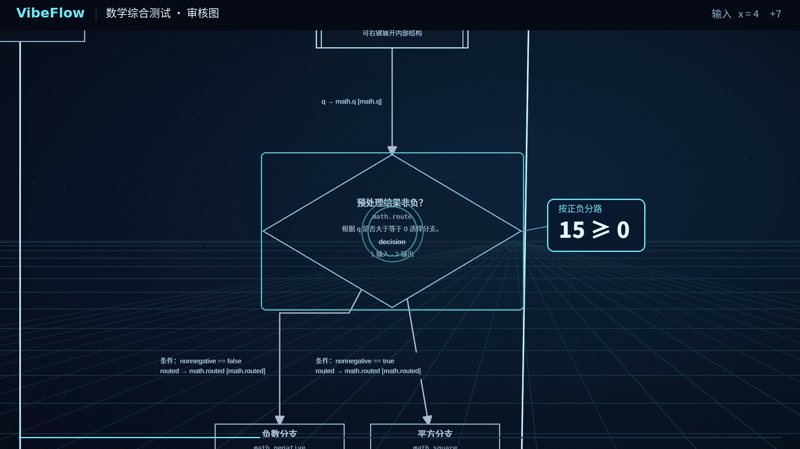

# VibeFlow

[中文](README.md)

**Let AI write the code. Keep the architecture in your hands.**

VibeFlow is a framework for building software with AI in Python and JavaScript / TypeScript. It organizes business logic into reusable Nodes and subworkflows called Nodesets. Workflows describe what runs and how data moves between steps. The review diagram and execution plan come from the same workflow. The framework checks workflow structure and input and output contracts, and can automatically apply the code quality rules your project selects.

Read the diagram to understand how your program works, then tell your agent exactly which step to change and what you expect it to do.

## Get started

1. Download the latest `vibeflow-distribution-<version>.zip` from [GitHub Releases](https://github.com/RockingSisyphus/vibeflow/releases/latest). Extract it into your project’s development directory and keep the package layout intact. This package is for development with human review. For unattended development, choose the ZIP with `autonomous` in its name.
2. Open your project directory in your coding agent. Ask it to read the extracted `AGENTS.md`, then give it your task.
   - **Migrate an existing project** — “Follow the `AGENTS.md` in the VibeFlow package. Migrate this project to VibeFlow and preserve its existing behavior. Verify the main flows and generate architecture previews for its workflows.”
   - **Start a new project** — “Follow the `AGENTS.md` in the VibeFlow package and build the project described below. Verify the main flows and generate architecture previews for the workflows.”

## Explore your project in the browser

Once your agent generates the previews, open **`vibeflow-preview.html`** from the extracted package in your browser. It works offline. Choose a workflow in the project directory and follow the arrows to see how data moves, branches, and comes back together. Right-click to expand a Nodeset or jump to a linked workflow.

If part of the diagram is hard to read, tell your agent exactly where you got lost.

> In Order Processing, I can’t tell which step checks stock and which step deducts it. Clarify the relevant node and connection descriptions, update the architecture documents, and regenerate the HTML preview.

Your agent can update names and descriptions in the workflow and resource declarations, then run `review` to regenerate the architecture documents and preview. Refresh the list in your browser to see the new snapshot.

## The workflow from the promo video

This math demo preprocesses the input in a Nodeset, then chooses a branch based on the sign of the result. Click the image for the full workflow. [Math demo source](sandbox/python/comprehensive_math/)

## Documentation

[User guide](distribution/docs/README.md) · [Quickstart](distribution/docs/user/quickstart.md) · [Reading and maintaining architecture](distribution/docs/user/architecture.md) · [Offline preview](distribution/docs/user/local-preview.md) · [Design and maintenance](docs/README.md)
