# VibeFlow

[中文](README.md)

VibeFlow structures AI-assisted programs as explicit workflows that can be executed, checked, and rendered as architecture views. Business logic lives in small Nodes, Config declares control flow, port contracts declare data flow, and Core validates the structure before execution or build.

```text
terminal start → input I/O → process / nodeset → output I/O → terminal end
```



## Main capabilities

- Python Runtime and JavaScript/TypeScript AOT;
- Python and JS/TS plugin SDKs for code-defined Nodes, Rules, Rulesets, and other resources explicitly selected by each workflow;
- composable Rules and Rulesets, plus Nodes, Nodesets, Loops, Capabilities, and explicit effect boundaries;
- explicit multi-file implementations, source ownership, per-file reviews, and default presentation for Nodes, BaseLibs, Plugins, and Hosts;
- deterministic Architecture JSONC, Mermaid, ASCII, and expanded SVG views with resource dependencies;
- config, contract, reachability, control-flow, quality, build, and execution-evidence checks;
- collaborative and autonomous development protocols over the same Core and machine rules.

VibeFlow reviews engineering structure, source health, and selected domain constraints. Project tests and production-environment acceptance verify business results and external behavior.

## Getting started

Download and extract one release package:

- `vibeflow-distribution-<version>.zip` for human-reviewed collaboration;
- `vibeflow-distribution-autonomous-<version>.zip` for unattended development.

The root `AGENTS.md` routes AI agents to task-specific documentation. Human readers can start at `kernel/docs/README.md`. Both packages include minimal `python_project/` and `javascript_project/` roots.

Python smoke run:

```bash
python run.py validate --config python_project/configs/main.jsonc
python run.py run --config python_project/configs/main.jsonc --input python_project/probe_input.json
```

JavaScript smoke run:

```bash
npm ci --prefix javascript_project
python run.py build --config javascript_project/configs/main.jsonc --target node --profile esm-module --out-dir javascript_project/build/node
node javascript_project/scripts/workflow_execution_probe.mjs
```

## Documentation

- [Project overview](distribution/docs/overview.md)
- [User development guides](docs/README.md#使用者开发)
- [Multi-file resources and presentation](distribution/docs/user/multifile-resources.md)
- [System design](docs/README.md#系统设计)
- [Kernel maintenance](docs/README.md#内核维护)

Run the complete source-repository gate with:

```bash
python tools/verify_project.py --full
```

Current distribution package version: `0.18.3`. Workflow ABI: `vibeflow.workflow.v5`.
