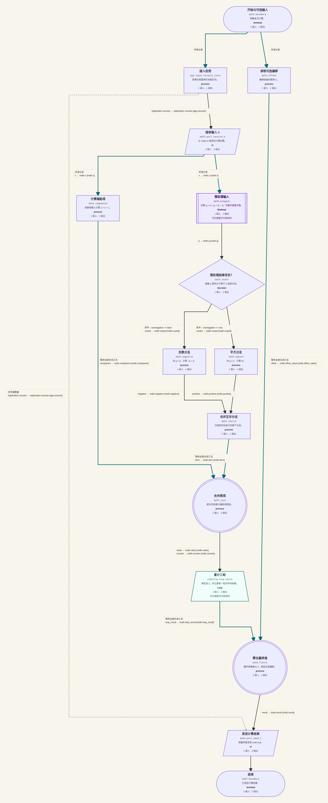

# VibeFlow

[English](README.en.md)

宣传视频：【vibeCoding得到的成果难以维护？如何让许愿式编程真正如你所愿？】 https://www.bilibili.com/video/BV1v71EzkEQd/?share_source=copy_web&vd_source=23fde6815e08fcaf6ba8974942ecc11f

**把实现交给 AI，把项目的架构掌握在自己手里。**

VibeFlow 是一个面向 AI 协作开发的编程框架，支持 Python 和 JavaScript / TypeScript。它把业务逻辑组织为可复用的节点（Node）和子流程（Nodeset），用工作流声明执行顺序和数据如何传递。审核图与执行计划来自同一份工作流。框架会检查流程结构和输入输出契约，也能按项目选用的规则自动检查代码质量。

你可以先看图理解程序如何工作，再告诉 Agent 哪个环节需要改、期望它怎么做。

## 开始使用

1. 从 [GitHub Releases](https://github.com/RockingSisyphus/vibeflow/releases/latest) 下载最新版 `vibeflow-distribution-<版本>.zip`，解压到你自己的项目开发目录，保留包内的目录结构。这个包适合边开发边审核。需要无人值守开发时，选带 `autonomous` 的 ZIP。
2. 在编码 Agent 中打开你的项目目录，让它读取解压后的 `AGENTS.md`，然后直接交给它任务。
   - **迁移已有项目**　“请按 VibeFlow 发行包里的 `AGENTS.md`，把这个项目迁移为 VibeFlow 项目，保留现有业务行为。完成后验证主要流程，并生成各工作流的架构预览。”
   - **开发新项目**　“请按 VibeFlow 发行包里的 `AGENTS.md`，用 VibeFlow 实现我下面给出的需求。完成后验证主要流程，并生成各工作流的架构预览。”

## 在浏览器里读懂项目

让 Agent 生成预览后，双击发行包根目录的 **`vibeflow-preview.html`**。它可以离线打开。在「项目目录」里选择工作流，沿箭头看数据经过哪些节点，在哪里分支、汇合。右键可以展开 Nodeset 或跳转到关联的工作流。

如果图读起来费劲，可以直接告诉 Agent 哪一段难懂。

> 「订单处理」里看不出哪一步校验库存、哪一步扣减库存。请把相关节点和连线的说明写清楚，更新架构文档并重新生成 HTML 预览。

Agent 可以调整工作流和资源声明中的名称、说明，再用 `review` 更新生成的架构文档和预览。回到浏览器刷新列表，就能查看新快照。

## 宣传片里的工作流

这是宣传片里数学示例的 VibeFlow 审核图。输入先进入预处理 Nodeset，再按结果的正负选择分支。在线预览中可以缩放画布、查看节点详情，也可以右键展开「预处理输入」或「累计三轮」。

[**打开交互审核图**](https://rockingsisyphus.github.io/vibeflow/) · [数学示例源码](sandbox/python/comprehensive_math/)

## 文档

[用户手册](distribution/docs/README.md)
