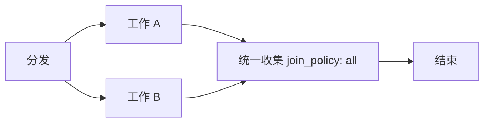

# 普通图并发与汇合

并发执行使用普通 Node、Nodeset 和正常调度边。每条执行分支都必须显式连接到下游，最终到达结束节点；不再存在独立任务图或隐式回收边界。

分发与收集是不同的普通节点。分发节点通过输出和正常边激活分支；收集节点使用 `join_policy: all`，等所有直接前驱本轮完成后执行一次。多值输入使用 `cardinality: all`，保留完整 envelope；结果按图中节点声明顺序交付，不按实际完成先后排序。收集后需要再次分发时，增加独立的下游分发节点。

调度器提交所有独立就绪节点，没有并发数量上限或线程池容量配置。依赖链自然串行，同层独立分支可并发。Python 使用线程执行同时就绪的节点；单个就绪节点可直接在调用线程运行。JavaScript 异步入口使用事件循环；同步入口保持同步调用约定，不提供 CPU Worker 并行。

节点只有在自身执行、`finally` 和 SDK 操作清理真正结束后，才向正常下游交付输出。失败触发同一工作流的协作取消；工作流等待已经启动的节点实际退出，再报告失败和清理错误。取消信号不能代替实际退出，不响应取消的操作仍由本次执行持有。JavaScript 的 `Promise.race` 失败方仍由当前节点持有至清理结束。

Python 的 `context.signal` 和 JavaScript 的 `context.signal` 保留取消协作；`context.capabilities` 与 `context.trace` 保留。节点不再取得启动其他节点或回收任务的控制器。业务中需要按结果选择后续路径时，使用普通 Decision 与数据边。

## 迁移

删除旧 `task_manager` 类型、`vibeflow.task_manager` Ruleset、`task_targets` 配置、TaskRef/TaskController/TaskOutcome、`context.tasks` 以及 `async_max_workers`。将隐藏目标移到 `pipeline.nodes`，补上分发到工作节点、工作节点到收集节点、收集节点到结束节点的显式边。不要只改名称而保留业务内部的启动和等待循环。

旧配置被明确拒绝，不提供兼容执行器。公共 Workflow ABI 为 `vibeflow.workflow.v8`；旧生成产物必须从迁移后的配置重新构建。图结构校验与流程图都使用相同的普通节点和边，断路检查对所有工作节点生效。
