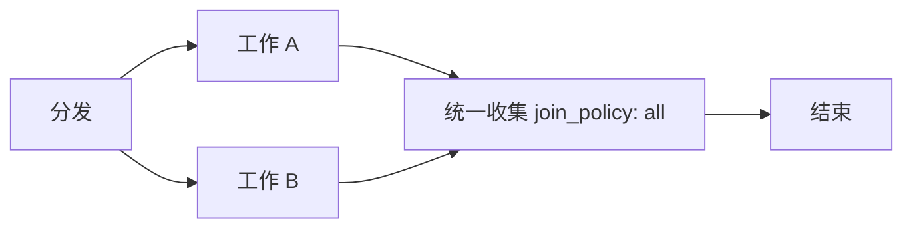

# 普通图并发与汇合

并发执行使用普通 Node、Nodeset 和正常调度边。每条执行分支都必须显式连接到下游，最终到达结束节点；不再存在独立任务图或隐式回收边界。



分发与收集是不同的普通节点。分发节点通过输出和正常边激活分支；收集节点使用 `join_policy: all`，等所有直接前驱本轮完成后执行一次。多值输入使用 `cardinality: all`，保留完整 envelope；结果按图中节点声明顺序交付，不按实际完成先后排序。收集后需要再次分发时，增加独立的下游分发节点。

标准 Workflow 规则将同一节点既回收又分发报告为错误 `GRAPH.JOIN.FORK_CONFLICT`，分支无法到达结束节点报告为错误 `GRAPH.FLOW.CANNOT_REACH_END`；验证和构建均拒绝这两类配置。

这里的连接是实际调度边。仅传数据的 `schedule: false` 边不构成到结束节点的执行路径；需要传数据时可另外声明，不能用它替代工作节点到收集节点的正常下游连接。

在分发节点的 `config` 中设置 `max_concurrency`，省略时默认 **8**，只接受正整数：

```jsonc
{
  "id": "dispatch",
  "type_used": "example.dispatch",
  "display_name": "分发",
  "description": "分发本轮工作",
  "config": {"max_concurrency": 4}
}
```

该额度只约束这次分发直接激活的节点调用。若有 8 个工作节点、额度为 4，先启动 4 个，其余排队；任意一个实际退出并完成清理，就立即补入下一个，不等整批结束。就绪调用按入队顺序获得名额，等待期间不消耗工作线程。不同分发节点各自计数，嵌套分发也有自己的额度；不会从 `global_config` 继承一个全局上限。需要限制一整段多节点工作时，将这段工作组成普通 Nodeset，再由分发节点调用；其名额保持到整个 Nodeset 返回。Loop 同样按完整调用计算。

`max_concurrency` 由框架读取，不需要加入业务 Node 的 `params_schema`，也不会传给业务实现的 `params`。它可以通过普通 `node_configs` 对指定调用覆写。收集仍由下游 `join_policy: all` 节点完成，与队列容量无关。失败或取消后不再启动排队调用，已启动调用仍须完成真实清理。

`1` 表示这次分发逐个执行；大于实际调用数量时只运行实际存在的调用。`0`、负数、非整数、布尔值和 `null` 均非法，不用它们表示无限并发。多个来源激活同一调用时，该调用须同时满足各来源的额度，退出后一起释放。

依赖链自然串行，同层独立分支可并发。Python 使用线程执行同时就绪的节点；单个就绪节点可直接在调用线程运行。JavaScript 异步入口使用事件循环；同步入口保持同步调用约定，不提供 CPU Worker 并行。

节点只有在自身执行、`finally` 和 SDK 操作清理真正结束后，才向正常下游交付输出。失败触发同一工作流的协作取消；工作流等待已经启动的节点实际退出，再报告失败和清理错误。取消信号不能代替实际退出，不响应取消的操作仍由本次执行持有。JavaScript 的 `Promise.race` 失败方仍由当前节点持有至清理结束。

Python 的 `context.signal` 和 JavaScript 的 `context.signal` 保留取消协作；`context.capabilities` 与 `context.trace` 保留。节点不再取得启动其他节点或回收任务的控制器。业务中需要按结果选择后续路径时，使用普通 Decision 与数据边。

## 从旧任务接口迁移

删除旧 `task_manager` 类型、`vibeflow.task_manager` Ruleset、`task_targets` 配置、TaskRef/TaskController/TaskOutcome、`context.tasks` 以及 `async_max_workers`。将隐藏目标移到 `pipeline.nodes`，补上分发到工作节点、工作节点到收集节点、收集节点到结束节点的显式边。不要只改名称而保留业务内部的启动和等待循环。

旧配置被明确拒绝，不提供兼容执行器。公共 Workflow ABI 为 `vibeflow.workflow.v8`，AOT manifest 仍为 `vibeflow.aot-build.v3`；manifest 版本未变不表示旧 Workflow 计划兼容。旧生成产物必须从迁移后的配置重新构建，并重新生成 Architecture 与流程图，再执行项目验证。图结构校验与流程图都使用相同的普通节点和边，断路检查对所有工作节点生效。
