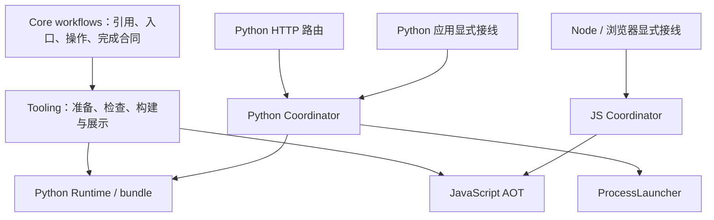

# Workflow 协作与 Python 原生异步

本轮将协作声明、实例管理和语言执行分开。Core 保存可移植事实，独立 Coordination 层管理 Python 实例，各 Target 执行已有公共计划。浏览器复用 JS 同进程组件。

Core 不持有实例、线程或 Promise。Python Coordination 不导入 Target；绑定是描述与执行回调。Python Target 的 workflow_host 将 Runtime 转成该执行接口。HTTP 服务持有显式事件循环，路由将请求提交给同一个 Coordinator；进程启动、回收和注册前失败由 ProcessLauncher 处理。启动器退出不能代替 workflow 终态。

Python scheduler 的就绪、输入、汇合、路由与额度状态只有一份。同步入口在当前调用内执行；原生异步入口在事件循环执行协程，为普通节点持有线程，并等待实际退出。Nodeset、Loop 与生成块使用同一调度状态。异步执行锁等待通过事件循环 Future 被唤醒；协程不阻塞等待 Condition。

Runtime 负责节点、Hook、dispose、锁和观察的真实完成；Coordinator 只在执行回调结束后写终态。停止请求和取消等待都不是终态。同步子调用不留下长期记录；异步终态由宿主显式释放。独立 Call 的执行上下文不会继承调用方的观察者或锁租约；同步嵌套保留锁重入，但观察与实例身份独立。

Python 同步子调用的登记和回收交给协作组件所属循环，目标计算保持在调用线程。同进程和 HTTP 宿主按语言共用错误报告函数，保留原因链、清理错误与错误组。Python 运行期和 HTTP 客户端复用独立于 Core、Target 的私有 cleanup 等待函数，取消不会代替实际完成。

构建产物的描述来自已准备的 WorkflowPlan 与调用声明；加载时不重新扫描工程。官方 invoke_sync/call/kill 与消息预期引用沿原有关联提取链展示。规则说明声明的能力和目标，不证明任意间接业务调用。

## 执行中的成本、目标与路线复核

首个原型已验证公共计划可承载 Python 协程和取消清理，无需另建图解释器。源码与搬迁后 AOT 均已贯通；Python 同进程真实 Runtime 和 JS 单文件 Node/Chromium 原型已验证身份隔离、消息、终态与实际清理。HTTP 与同进程 Python 使用同一状态组件，JS 浏览器原型无网络请求。这些证据支持保持原目标与分层。

实现与迁移已完成。实践中的主要成本集中在普通线程与协程的实际退出、取消和插件清理、错误信息保留，以及源码/AOT/各 profile 的一致性。公共计划、协作状态和通用 JS 组件均得到复用，没有增加第二套图解释器或页面业务依赖。收尾探针补齐了静态验证与构建诊断、同步调用线程、错误传播和取消收尾的组合覆盖；定向检查及最终完整门禁均通过。共享 Python cleanup 等待函数归属 Coordination，两个使用方复用同一实现，Core 保持纯声明。

两端原型、HTTP/浏览器复用、旧实现退役及最终全量前的复核均支持原目标与分层。后续仍根据实际工作量、验证代价、维护负担和目标假设判断路线；需要实质改变同步语义、取消效果或独立实例生命周期时，先核查，再提供可独立阅读的中文说明交由用户判断。常规等价选择自主处理，不增加固定审批或额外验收批次。

本轮不包含 ERA 生产迁移、酒馆业务、页面刷新恢复、版本发布或推送。

## 验收记录（2026-10-23）

验收在本机 Linux 的隔离副本执行，运行前与工作区逐文件核对，1905 个文件一致；原工作区既有的 runs 记录保持原样。每轮完整批次保持代码与测试冻结。早期批次的迁移遗漏和共享模块归属失败均已集中修复；中间版本的通过不替代最终版本结论。

| 范围 | 最终结果与证据 |
|---|---|
| 源码与架构 | 全部静态 profile 通过，0 错误、0 警告；Coordination 不导入 Target，旧根目录 helper 已删除 |
| 定向行为 | 101 项通过，包含同步线程与身份、消息/等待/停止、异步生命周期、错误组、原因链、重复取消和实际清理 |
| 正式全量 | `python tools/verify_project.py --full --workers 12`：18/18，通过；pytest 4948/4948 |
| 沙箱与规则 | Python 102/102；JS 集成 50/50、0 跳过；规则对照 1115/1115、0 差异；规则缺口与适配回归通过 |
| 真实浏览器 | 已打包 AOT 在实际 Chromium 运行；同步返回、消息往返、停止/关闭等待 finally 清理、协作期间零网络请求通过；官方 InvokeSync 关联与命名入口跳转通过 |
| AOT 与分发 | 搬迁并移除原工程后的 Python bundle、Node AOT、wheel 隔离安装，以及两种发行候选装配与脱离源码运行通过 |
| 迁移 | 启动清单 v2、Workflow ABI v11、共享 AOT v5；旧格式明确拒绝并要求重建；跨语言进程协作继续通过 |
| 收尾 | 全量末尾仓库检查通过，清理检查为 0 个目标；最终仅补写本验收记录并再次进行静态检查 |

本次最终完整门禁约 25 分钟。后续维护的主要验证成本仍是跨语言、源码/AOT、原生异步与真实宿主的一致性；本轮没有引入浏览器页面业务适配层。上述结果不代表 Windows 平台、ERA 酒馆生产、长期高频运行或刷新恢复验收。

## 后续补充：三个 Workflow 数学协作沙箱（2026-10-23）

新增 [Python](../../sandbox/python/workflow_cooperation_math/README.md) 与 [JavaScript](../../sandbox/javascript/workflow_cooperation_math/README.md) 正式沙箱，并接入各自 integration 和根目录 full 入口。A、B 为独立异步 workflow，B 同步调用独立 C；两轮消息与 B 的终态输出共同构成 `F=6(3x-y+8)²-27x+43y-180`。图、输入及独立展开式判据共用一份测试资料，各语言维护自己的普通 SDK 数学节点，协作操作复用发行包官方模板。

五组输入并发执行，逐项核对中间值、消息轮次、发送者及实例身份；检查同步立即返回、异步目标拒绝、同步记录回收、终态重复读取和记录释放。四个错误公式对照实际得到 3631、196、376、358，均不能通过正确答案 361 的判据。B 第二轮 Nodeset 保持 B 的实例归属，没有新增 workflow 或协作实现。

| 本次补充验证范围 | 结果 |
|---|---|
| Python 联合计算 | 源码及移除原项目后的 AOT，各自 plan/block/compiled 全部通过；每组五个父运行的实测峰值均为 5 |
| JS 联合计算 | 同一实际单文件 AOT 脚本在 Node、真实无头 Chromium 中全部通过；父运行峰值为 5；Chromium 离线页注入及执行期间网络请求为 0 |
| Python 正式 integration 批次 | 修复后重新完整执行，103/103 通过 |
| JavaScript 正式 integration 批次 | 51/51 通过，0 跳过 |
| 仓库检查 | 最终源码隔离副本的 `repo_check --profile all` 通过，0 错误、0 警告；diff 空白检查通过 |

首次 Python 正式批次为 102/103：新增并发断言误将启动过程限定为两轮事件循环，过早检查实例数。整批完成后，将断言改为记录真实 runner 的进入、退出及峰值，先通过定向复验，再重跑整个 Python integration 批次。没有放宽公式、身份或并发预期。

本次只增加沙箱、共享测试资料及文档，没有修改协作产品代码。以上是新增场景和两端 integration 批次的结论，本次未重跑整个项目的 18 步 full 门禁、wheel 或发行候选验证；上面的完整门禁记录属于此次补充之前的版本。仍未涉及 ERA 生产、长期运行、刷新恢复或 Windows 验收。

## 项目维护复核（2026-10-23，1.4.0 构建后）

按项目维护 skill 检查了 Core 合同、协作状态归属、Python 同步与原生异步执行、生命周期、源码准备与资源使用、AOT 绑定、架构资料路径、迁移拒绝路径和分发资源。检查沿实际入口追踪，没有仅根据名称将仍有用途的机制判为退役。现有分层与显式绑定合同继续适用；本次没有增加浏览器业务适配或改变实例生命周期。

发现并复现一处缺陷：Python 异步图的普通同步节点在框架工作线程执行，官方 Send 模板通过 HTTP Client 的 `operations()` 绑定调用 `send()` 时，直接在该线程创建 asyncio Task，报 `RuntimeError: no running event loop`。既有 HTTP 用例在协程节点内发送，未覆盖这个组合。

将同进程 Coordinator 已有的即时操作线程转交逻辑收拢到 `coordination/operations.py`，HTTP Client 共用该实现。消息交接在宿主事件循环完成，Send 仍立即返回，实际 HTTP 交付仍由 flush/finish 等待；同步嵌套计算继续在调用线程执行。使用手册同步说明了操作绑定与底层 Client 的调用边界。

新增[正式 AOT 的 HTTP 协作回归](../../tests/coordination/test_http_sdk.py)，复用三 workflow 数学沙箱：A 通过 HTTP 调用并收发消息，服务端绑定实际 B/C 产物，B 在同进程同步调用 C。删除原工程后，在 plan/block/compiled 三种 profile 中分别运行五组并发输入，检查公式、中间值、实例身份和可重复读取的终态。没有增加另一套数学节点或协作协议。

| 本次复核验证范围 | 结果 |
|---|---|
| 缺陷复现与定向复验 | 修复前新增用例失败，修复后通过；协作定向批次 33/33 通过。首次批次有 5 项因相对 PYTHONPATH 导致子进程导入失败，修正为绝对路径后整批重跑通过 |
| 源码与 wheel 退役检查 | 现有 `tools/audit_retired_architecture.py` 对源码及实际 wheel 均为 PASS，0 个残留问题 |
| 正式完整门禁 | `python tools/verify_project.py --full --workers 12`，18/18 通过，约 25 分钟；主测试集 4950/4950 |
| 两端沙箱 | Python 103/103；JS 集成 51/51、0 跳过；Node 与真实无头 Chromium 的联合计算通过，浏览器协作期间零网络请求 |
| 规则与展示 | 规则对照 1115/1115；规则缺口 194/194；适配回归 173/173；运行观测、布局、资源分区及两端审查性能回归通过 |
| 独立产物 | wheel 隔离安装、两种临时候选包及移除原工程后的 AOT 执行通过 |
| 收尾 | 最终仓库质量检查 0 错误、0 警告，清理检查 0 个目标；最后仅补写本记录，再次静态检查 |

完整批次在与本次源码逐文件核对的 1929 文件隔离副本执行，批次期间代码与测试保持冻结，原工作区的用户运行记录保留。没有重建、替换已有 1.4.0 分发包，也没有新增 Git 提交或推送；已有包不包含本次修复。临时候选与运行材料使用任务专用临时目录，验收后清理。

剩余维护项：可选 Mermaid 渲染工具的 `npm audit` 报告 5 项低严重级别提示，均沿依赖链指向同一项 [KaTeX 上游公告](https://github.com/advisories/GHSA-238p-pmpm-9mq7)。这不是 5 个独立缺陷，也没有证明本项目存在公告要求的原型污染前提。报告给出的 Mermaid 修复涉及跨主版本升级，本次保留工具链版本；后续升级需核对实际渲染和布局结果，不直接执行 `npm audit fix --force`。上述验收仍不代表 Windows、ERA 酒馆生产、长期高频运行或刷新恢复验收。

## 预览与协作收尾复核（2026-10-23）

跨 workflow 右键跳转优先选择目标自己的预览记录，与左侧列表切换一致；各 workflow 的位置、展开与阅读状态独立保留。Wait 的默认形状统一为其他官方协作操作使用的缺口矩形，保留其颜色及作者显式样式覆盖。

按用户确认，仅调整共享规则 `WORKFLOW.CALL.UNOBSERVED`：Wait 和 CallAndWait 不再豁免缺少 Kill 的警告；保留 warning 级别及 `allow_background: true`。规则仍只确认直接数据关联的 Kill 声明，不证明所有异常路径都执行清理。本次没有增加自动停止、异常分支或新的运行时收尾合同。

三个 workflow 数学沙箱增加显式停止分支：五组正常公式与一组停止场景在同一作用域并发，核对 18 个独立 A/B/C 身份。A 在 B 第二轮等待就绪后调用官方 Kill；Kill 返回后立即以零超时读取清理确认，要求 B 的真实异步 `finally` 已完成、终态为 cancelled 且没有数值输出。其他五组答案及四个错误公式对照保持原判据。A 的正常第二轮放入同实例 Nodeset，隔离官方 Wait 与 Kill 固定的同名输出键；B 的 Nodeset 也继续保持 B 身份，没有增加第四个 workflow 或另一套执行器。

新增实际停止场景暴露出 Python 嵌套取消边界：多处重复取消及延迟到达的取消可能打断用户异步 `finally`。协调组件与调度器复用单次取消请求，已中止的等待在操作边界交付原生取消。补充公开 API 回归还复现了“任务已处理一次取消，再用已中止信号接收排队消息”会误消费消息的问题；修复后立即取消并保留消息。两处修复维护既有实际清理语义，没有引入父流程退出自动停止子流程的机制。

| 最终验证范围 | 结果 |
|---|---|
| 定向行为 | 138/138；两端规则覆盖无收尾、仅 Wait、CallAndWait、直接 Kill 和显式 background；取消边界回归修复前失败、修复后通过 |
| 正式完整门禁 | `python tools/verify_project.py --full --workers 12`：18/18，通过，约 27 分钟；主测试 4962/4962 |
| 两端沙箱 | Python 103/103；JS 集成 51/51，0 跳过；源码及移除原工程后的 AOT、Python 三种 profile 通过 |
| 真实宿主 | 同一 JS 打包产物在 Node 与真实无头 Chromium 中通过正常公式、停止清理及错误对照；浏览器协作期间网络请求为 0 |
| 规则及展示 | 规则对照 1115/1115、缺口 194/194、适配回归 173/173；独立阅读状态、布局、资源展示和两端预览性能回归通过 |
| 独立包与收尾 | wheel 隔离安装、两种临时候选包通过；末尾仓库检查 0 错误、0 警告，清理目标 0；最后仅补写本记录并复查静态质量与 diff |

首轮完整批次也为 18/18（主测试 4961 项），但不包含随后补充的取消边界回归及 JS 运行身份跟踪修正；以上结论以最终完整批次为准。最终批次使用与工作区逐文件核对的 1933 文件隔离副本，运行期间源码与测试冻结，主工作区既有运行记录保留。新版 A/B/C 预览已生成并保留旧快照；临时构建、候选包与运行材料验收后清理。

实践证据继续支持既有分层：共享声明规则独立维护，各语言协作组件管理实际生命周期，沙箱使用正式 Runtime/AOT。没有新增页面业务依赖。未替换已有 1.4.0 分发文件，未提交、推送或发布；1.4.1 发布继续暂停。以上仍不代表 Windows、ERA 酒馆生产、长期高频运行或刷新恢复验收。

## 1.4.1 发布平台复验补充（2026-10-23）

用户恢复发布后，Windows CI 首轮发现 JS 同进程回归直接启动 Unix 风格 esbuild 包装脚本，报 WinError 193；改用正式 JavaScript API，并同步迁移数学沙箱中的同类调用。Node 与真实无头 Chromium 定向复验均通过，Windows 后续为 131 项通过、2 项浏览器依赖相关跳过。

Linux Node 22/24 的完整批次均跑完 18 个步骤，其中 17 个通过；唯一失败是 Python 数学沙箱源码执行外层 45 秒超时，Python 沙箱为 102/103。不能用其他步骤或既往本机全量覆盖该失败。源码入口会重复进行工程准备与审核；Python 3.11 原始沙箱在本机通过，受控增加准备耗时后，同组全部公式、身份和 Kill 清理断言仍通过：约 103.7 秒中约 88.8 秒位于 43 次准备调用。这证明原来的批次墙钟上限混入了源码审核成本，不能据此判定协作挂起。

仅为 checked-source 六组父调用按每组 45 秒分配外层总预算；AOT 继续使用原来的 45 秒上限，单次错误公式对照、消息协议、业务断言及零超时清理确认不变。未修改协作运行时或公开合同。Python 3.11 完整沙箱复验 103/103；首次复验环境漏装 pytest 导致的两项环境失败已收齐，补全项目声明依赖后，两项定向复验及完整批次均通过。

本次修正后重新验证最终发布提交。最终发布状态、平台 CI 与资产校验以对应 GitHub Release 记录为准；以上历史失败与定向结果不替代最终完整结果。
