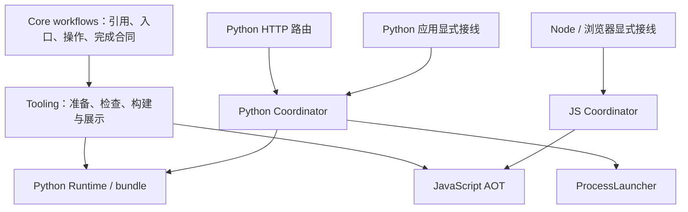

# Workflow 协作与 Python 原生异步

本轮将协作声明、实例管理和语言执行分开。Core 保存可移植事实，独立 Coordination 层管理 Python 实例，各 Target 执行已有公共计划。浏览器复用 JS 同进程组件。

Core 不持有实例、线程或 Promise。Python Coordination 不导入 Target；绑定是描述与执行回调。Python Target 的 workflow_host 将 Runtime 转成该执行接口。HTTP 服务持有显式事件循环，路由将请求提交给同一个 Coordinator；进程启动、回收和注册前失败由 ProcessLauncher 处理。启动器退出不能代替 workflow 终态。

Python scheduler 的就绪、输入、汇合、路由与额度状态只有一份。同步入口在当前调用内执行；原生异步入口在事件循环执行协程，为普通节点持有线程，并等待实际退出。Nodeset、Loop 与生成块使用同一调度状态。异步执行锁等待通过事件循环 Future 被唤醒；协程不阻塞等待 Condition。

Runtime 负责节点、Hook、dispose、锁和观察的真实完成；Coordinator 只在执行回调结束后写终态。停止请求和取消等待都不是终态。同步子调用不留下长期记录；异步终态由宿主显式释放。独立 Call 的执行上下文不会继承调用方的观察者或锁租约；同步嵌套保留锁重入，但观察与实例身份独立。

Python 同步子调用的登记和回收交给协作组件所属循环，目标计算保持在调用线程。同进程和 HTTP 宿主按语言共用错误报告函数，保留原因链、清理错误与错误组。Python 运行期和 HTTP 客户端复用独立于 Core、Target 的私有 cleanup 等待函数，取消不会代替实际完成。

构建产物的描述来自已准备的 WorkflowPlan 与调用声明；加载时不重新扫描工程。官方 invoke_sync/call/kill 与消息预期引用沿原有关联提取链展示。规则说明声明的能力和目标，不证明任意间接业务调用。

## 执行中的成本、目标与路线复核

首个原型已验证公共计划可承载 Python 协程和取消清理，无需另建图解释器。源码与搬迁后 AOT 均已贯通；Python 同进程真实 Runtime 和 JS 单文件 Node/Chromium 原型已验证身份隔离、消息、终态与实际清理。HTTP 与同进程 Python 使用同一状态组件，JS 浏览器原型无网络请求。这些证据支持保持原目标与分层。

实现与迁移已完成。实践中的主要成本集中在普通线程与协程的实际退出、取消和插件清理、错误信息保留，以及源码/AOT/各 profile 的一致性。公共计划、协作状态和通用 JS 组件均得到复用，没有增加第二套图解释器或页面业务依赖。收尾探针补齐了静态验证与构建诊断、同步调用线程、错误传播和取消收尾的组合覆盖；定向检查及最终完整门禁均通过。共享 Python cleanup 等待函数归属 Coordination，两个使用方复用同一实现，Core 保持纯声明。

两端原型、HTTP/浏览器复用、旧实现退役及最终全量前的复核均支持原目标与分层。后续仍根据实际工作量、验证代价、维护负担和目标假设判断路线；需要实质改变同步语义、取消效果或独立实例生命周期时，先核查，再提供可独立阅读的中文说明交由用户判断。常规等价选择自主处理，不增加固定审批或额外验收批次。

本轮不包含 ERA 生产迁移、酒馆业务、页面刷新恢复、版本发布或推送。

## 验收记录（2026-10-23）

验收在本机 Linux 的隔离副本执行，运行前与工作区逐文件核对，1905 个文件一致；原工作区既有的 runs 记录保持原样。每轮完整批次保持代码与测试冻结。早期批次的迁移遗漏和共享模块归属失败均已集中修复；中间版本的通过不替代最终版本结论。

| 范围 | 最终结果与证据 |
|---|---|
| 源码与架构 | 全部静态 profile 通过，0 错误、0 警告；Coordination 不导入 Target，旧根目录 helper 已删除 |
| 定向行为 | 101 项通过，包含同步线程与身份、消息/等待/停止、异步生命周期、错误组、原因链、重复取消和实际清理 |
| 正式全量 | `python tools/verify_project.py --full --workers 12`：18/18，通过；pytest 4948/4948 |
| 沙箱与规则 | Python 102/102；JS 集成 50/50、0 跳过；规则对照 1115/1115、0 差异；规则缺口与适配回归通过 |
| 真实浏览器 | 已打包 AOT 在实际 Chromium 运行；同步返回、消息往返、停止/关闭等待 finally 清理、协作期间零网络请求通过；官方 InvokeSync 关联与命名入口跳转通过 |
| AOT 与分发 | 搬迁并移除原工程后的 Python bundle、Node AOT、wheel 隔离安装，以及两种发行候选装配与脱离源码运行通过 |
| 迁移 | 启动清单 v2、Workflow ABI v11、共享 AOT v5；旧格式明确拒绝并要求重建；跨语言进程协作继续通过 |
| 收尾 | 全量末尾仓库检查通过，清理检查为 0 个目标；最终仅补写本验收记录并再次进行静态检查 |

本次最终完整门禁约 25 分钟。后续维护的主要验证成本仍是跨语言、源码/AOT、原生异步与真实宿主的一致性；本轮没有引入浏览器页面业务适配层。上述结果不代表 Windows 平台、ERA 酒馆生产、长期高频运行或刷新恢复验收。

## 后续补充：三个 Workflow 数学协作沙箱（2026-10-23）

新增 [Python](../../sandbox/python/workflow_cooperation_math/README.md) 与 [JavaScript](../../sandbox/javascript/workflow_cooperation_math/README.md) 正式沙箱，并接入各自 integration 和根目录 full 入口。A、B 为独立异步 workflow，B 同步调用独立 C；两轮消息与 B 的终态输出共同构成 `F=6(3x-y+8)²-27x+43y-180`。图、输入及独立展开式判据共用一份测试资料，各语言维护自己的普通 SDK 数学节点，协作操作复用发行包官方模板。

五组输入并发执行，逐项核对中间值、消息轮次、发送者及实例身份；检查同步立即返回、异步目标拒绝、同步记录回收、终态重复读取和记录释放。四个错误公式对照实际得到 3631、196、376、358，均不能通过正确答案 361 的判据。B 第二轮 Nodeset 保持 B 的实例归属，没有新增 workflow 或协作实现。

| 本次补充验证范围 | 结果 |
|---|---|
| Python 联合计算 | 源码及移除原项目后的 AOT，各自 plan/block/compiled 全部通过；每组五个父运行的实测峰值均为 5 |
| JS 联合计算 | 同一实际单文件 AOT 脚本在 Node、真实无头 Chromium 中全部通过；父运行峰值为 5；Chromium 离线页注入及执行期间网络请求为 0 |
| Python 正式 integration 批次 | 修复后重新完整执行，103/103 通过 |
| JavaScript 正式 integration 批次 | 51/51 通过，0 跳过 |
| 仓库检查 | 最终源码隔离副本的 `repo_check --profile all` 通过，0 错误、0 警告；diff 空白检查通过 |

首次 Python 正式批次为 102/103：新增并发断言误将启动过程限定为两轮事件循环，过早检查实例数。整批完成后，将断言改为记录真实 runner 的进入、退出及峰值，先通过定向复验，再重跑整个 Python integration 批次。没有放宽公式、身份或并发预期。

本次只增加沙箱、共享测试资料及文档，没有修改协作产品代码。以上是新增场景和两端 integration 批次的结论，本次未重跑整个项目的 18 步 full 门禁、wheel 或发行候选验证；上面的完整门禁记录属于此次补充之前的版本。仍未涉及 ERA 生产、长期运行、刷新恢复或 Windows 验收。
